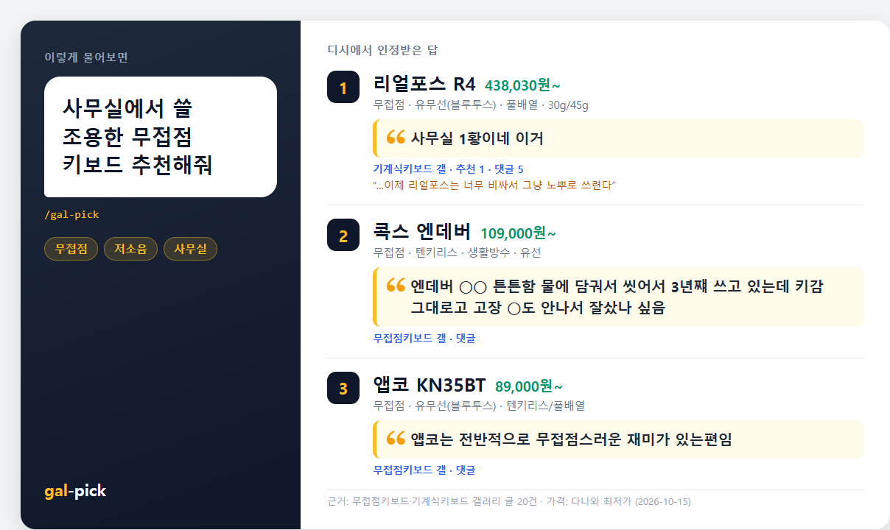
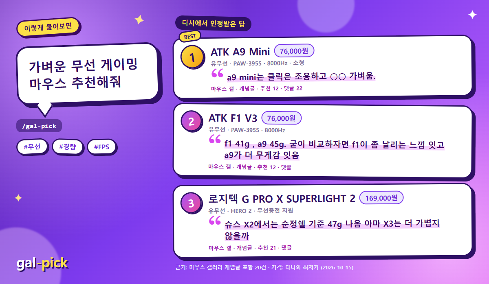
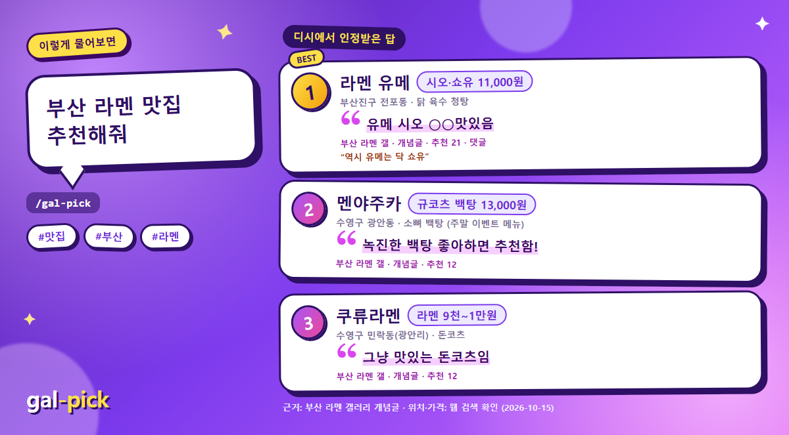
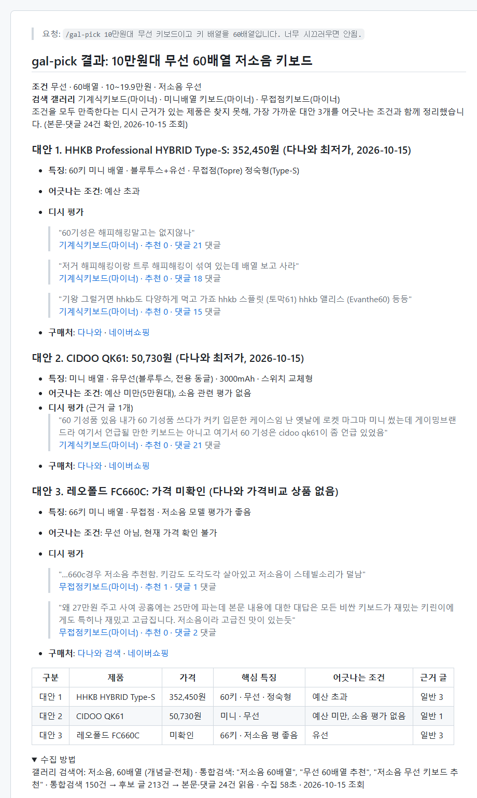
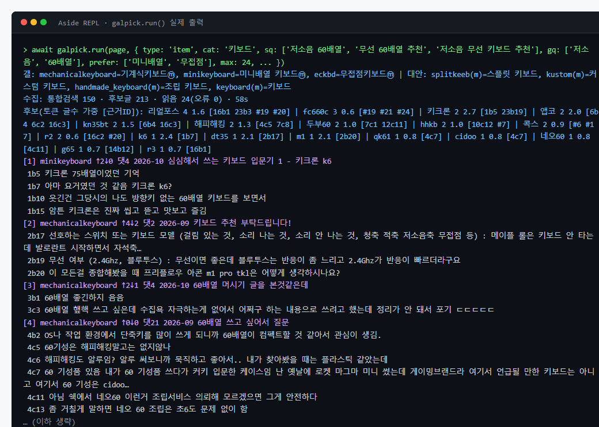

<div align="center">

# 🎯 gal-pick

### 광고 말고, 디시에서 인정받은 물건을 찾아 드립니다

디시인사이드 전문 갤러리의 글과 댓글을 근거로 조건에 맞는 제품(또는 맛집·명소)을 골라 주는<br>
[Aside](https://asidehq.com) 브라우저용 에이전트 스킬입니다.


[💬 사용 예시](#-이렇게-물어보면-이렇게-찾아옵니다) · [📦 설치](#-설치) · [⚙️ 동작 방식](#️-동작-방식) · [⚠️ 주의](#️-주의)

</div>

<br>

## 🤔 왜 gal-pick 인가?

> **바이럴 광고글에 지쳐서 만들었습니다.**

쿠팡 후기를 봐도 AI로 쓴 듯한 광고성 글과 5점 만점 평가만 가득해서, 진짜 써 본 사람의 리얼한 후기가 항상 궁금했습니다. 그래서 날것의 평가가 오가고 비판과 토론이 상시 이루어지는 디시인사이드에서 물건을 찾기 시작했습니다. 이곳에서는 조금만 광고 같아도 관심을 주지 않고, 무엇이 최고의 제품인지를 두고 토론합니다.

gal-pick은 여기서 착안했습니다. 구글 검색에서 벗어나, **디시인사이드에서 인정받은 물건을 쉽게 검색해 찾을 수 있게** 해 주는 스킬입니다.

<br>

## 💬 이렇게 물어보면, 이렇게 찾아옵니다

평소 말투로 원하는 걸 물어보세요. gal-pick이 그 분야 디시 갤러리의 개념글과 댓글을 읽고 **디시에서 인정받은 답**을 가져옵니다. 아래는 모두 실제로 실행한 결과입니다. (2026-10-15 조회)

| 🗣️ 디시 원문 그대로 | 💰 지금 가격·구매 링크 | ✅ 조건 검증 |
|---|---|---|
| 한 글자도 고치지 않은 인용과 갤러리·개념글·추천 수, 원문 링크 | 다나와 최저가와 옵션별 가격<br>맛집은 위치·메뉴 가격·지도 링크 | 조건에 안 맞으면 빼고, 딱 맞는 게 없으면 가장 가까운 대안을 솔직하게 |

### ⌨️ “사무실에서 쓸 조용한 무접점 키보드 추천해줘”



<sub>📎 전체 결과와 원문 링크: [examples/office-keyboard.md](examples/office-keyboard.md)</sub>

### 🖱️ “가벼운 무선 게이밍 마우스 추천해줘”



<sub>📎 전체 결과와 원문 링크: [examples/light-mouse.md](examples/light-mouse.md)</sub>

### 🍜 “부산 라멘 맛집 추천해줘” 맛집도 됩니다



<sub>📎 전체 결과와 원문·지도 링크: [examples/busan-ramen.md](examples/busan-ramen.md)</sub>

### 🙅 조건이 까다로우면? 지어내지 않습니다

“10만원대 + 무선 + 60배열 + 저소음”처럼 조건을 다 만족하는 제품에 대한 디시 근거가 없으면, 그럴듯한 답을 지어내는 대신 가장 가까운 대안과 어긋나는 조건을 알려 줍니다.

<details><summary>👀 결과 화면 보기</summary>



원본: [examples/keyboard-60-silent.md](examples/keyboard-60-silent.md)

</details>

### 💡 이런 것도 물어보세요

```
/gal-pick 20만원대 노이즈캔슬링 무선 이어폰, 통화 품질 중요
/gal-pick 자취생 가성비 전기밥솥
/gal-pick 초보 캠핑용 2인 텐트 30만원 이하
/gal-pick 성수동 혼밥하기 좋은 라멘집
/gal-pick 미니배열키보드갤에서만, 무선 40배열 키보드
```

> [!TIP]
> - 💸 **예산**: "10만원대"는 100,000~199,999원, "10만원 이하"는 ~100,000원, "10만원 안팎"은 80,000~120,000원으로 해석합니다.
> - 🎯 **갤러리 지정**: "○○갤에서만"처럼 말하면 그 갤러리에서만 찾습니다.
> - 📍 **맛집·장소**: 웹 검색으로 위치와 영업 여부를 확인하고 네이버 지도·카카오맵 링크를 붙입니다.

<br>

## 📦 설치

설치하면 Aside의 모든 작업에서 `/gal-pick`을 쓸 수 있습니다. 아래 세 방법 중 **하나만** 하면 됩니다.

### 1️⃣ Aside에게 부탁하기 ✨ 가장 쉬움

Aside 채팅창에 아래 문장을 그대로 붙여 넣으세요.

```
https://github.com/sehunYang/gal-pick 의 gal-pick 폴더를 내 Aside 계정 스킬(skills/user/gal-pick)로 설치해줘. SKILL.md의 GP 경로는 설치한 scripts/galpick.js 절대 경로로 바꿔줘.
```

### 2️⃣ 명령 한 줄 (Windows)

PowerShell을 열고 아래 한 줄을 붙여 넣으세요. 파일을 내려받고 `GP` 경로 설정까지 자동으로 합니다.

```powershell
$ErrorActionPreference='Stop'; $d="$env:USERPROFILE\.aside\u\0\skills\user\gal-pick"; $b="https://raw.githubusercontent.com/sehunYang/gal-pick/main/gal-pick"; New-Item -ItemType Directory -Force "$d\scripts" | Out-Null; Invoke-WebRequest "$b/scripts/galpick.js" -OutFile "$d\scripts\galpick.js" -UseBasicParsing; Invoke-WebRequest "$b/SKILL.md" -OutFile "$d\SKILL.md" -UseBasicParsing; $p=($d -replace '\\','/')+'/scripts/galpick.js'; $t=[IO.File]::ReadAllText("$d\SKILL.md"); [IO.File]::WriteAllText("$d\SKILL.md", [regex]::Replace($t, "'<[^>]+>/scripts/galpick\.js'", "'$p'")); "Installed: $d"
```

> [!NOTE]
> - `Installed: ...`가 보이면 끝입니다. 최신 버전으로 업데이트할 때도 같은 줄을 다시 실행하면 됩니다.
> - Aside에 계정을 여러 개 연결했다면 `u\0`의 숫자를 해당 계정 번호로 바꾸세요.

### 3️⃣ 직접 복사

이 저장소의 `gal-pick` 폴더를 Aside 계정 스킬 폴더에 복사합니다.

```
<Aside 계정 루트>/skills/user/gal-pick/
├── SKILL.md
└── scripts/galpick.js
```

- 🪟 Windows 예: `C:\Users\<사용자>\.aside\u\0\skills\user\gal-pick`
- 📁 특정 프로젝트에서만 쓰려면 `<프로젝트>/.agents/skills/gal-pick`에 둡니다.
- 🔧 `SKILL.md`의 `GP` 값을 설치한 `scripts/galpick.js`의 절대 경로로 바꾸면 가장 확실합니다.

<br>

## ⚙️ 동작 방식

```
요청 분석 ─▶ galpick.run()                                    ─▶ 후보 판단 ─▶ galpick.finish()          ─▶ 결과
             통합검색(정확도순) → 갤러리 3곳 자동 선정                         다나와 동시 조회(카테고리·
             → 목록 → 제목 관련도 우선 선별(판매글 제외)                        액세서리 필터, 옵션별 가격)
             → 본문·댓글 최대 30건 → 후보 토큰 집계                             + ID로 고른 인용을 원문·링크로 확정
             → 문장 은행(ID 부여) 반환
```

| | |
|---|---|
| 🪶 **토큰 절약** | 디시·다나와 페이지를 스냅샷으로 읽지 않습니다. 헬퍼 스크립트가 필요한 부분만 잘라 짧은 텍스트로 돌려줘요. 도구 호출은 REPL 2회(`run`, `finish`)가 기본입니다. |
| 🔒 **인용 신뢰성** | 에이전트는 문장 ID만 고르고, 원문과 링크는 헬퍼가 채웁니다. 서로 다른 글쓴이의 문장은 이어 붙일 수 없고, 긴 댓글은 제품명이 들어간 2문장만 원문 그대로 발췌합니다. |
| 🎯 **관련도 우선** | 제목에 조건 단어가 있거나 질문·후기형인 글을 먼저 읽고, 그 안에서 개념글·추천·댓글 수로 가중합니다. |

수집 단계에서 `galpick.run()`이 에이전트에게 돌려주는 요약입니다(실제 출력의 앞부분). 갤러리 선정, 수집 통계, 후보 집계, 문장 ID가 붙은 "문장 은행"으로 구성됩니다.



### 📊 실측 (무선 60배열 저소음 키보드 조건 기준)

| 항목 | 값 |
|---|---|
| ⏱️ 수집(`run`) | 통합검색 150건 → 후보 글 213건 → 본문·댓글 24건, 약 58초 |
| 📏 `run` 출력 크기 | 약 4,300자 (글 1건당 약 200자) |
| 💰 가격·인용 확정(`finish`) | 후보 4개, 약 10초 |
| 🎯 읽은 글 중 조건과 관련된 글 | 20건 중 19건 (같은 조건, 본문 20건 검증 실행) |

<br>

## 🗂️ 파일 구조

```
gal-pick/SKILL.md            에이전트 작업 지침 (조건 분석 → run → 판단 → finish → 출력)
gal-pick/scripts/galpick.js  수집·집계·다나와 조회·인용 확정 헬퍼 (Aside REPL에서 eval로 로드)
examples/                    실제 실행 결과 예시
docs/images/                 README 이미지
```

<br>

## ⚠️ 주의

> [!WARNING]
> - 🐢 **정상 브라우징 범위만**: 요청 사이에 0.8~1초 간격을 두고, 한 번 실행에 본문은 최대 30건만 읽습니다. robots.txt로 막힌 m.dcinside.com은 쓰지 않고, 캡차나 차단은 우회하지 않습니다. 차단이 감지되면 검색 스니펫만으로 진행하고 그 사실을 결과에 표시합니다.
> - ✍️ **저작권**: 인용은 출처 링크를 붙인 짧은 발췌입니다. 원문 저작권은 각 작성자에게 있습니다.
> - 🏷️ **비공식 도구**: 디시인사이드·다나와와 관계없습니다. 사이트 구조가 바뀌면 동작하지 않을 수 있습니다.
> - 🔍 **참고 자료**: 추천은 커뮤니티 의견을 모은 것입니다. 구매 전에 사양과 가격을 직접 확인하세요.

<br>

## 📄 라이선스

[MIT](LICENSE) © sehunYang
